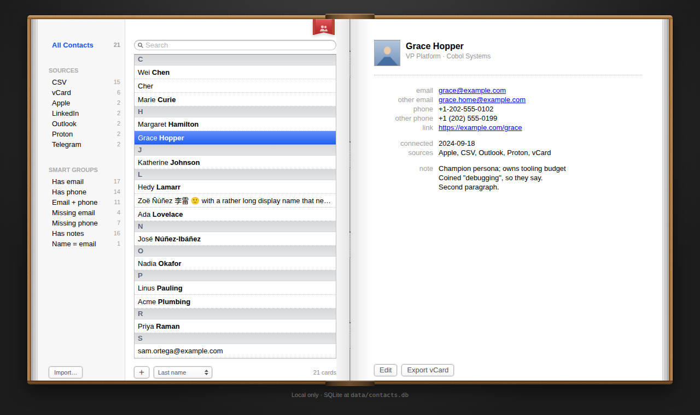
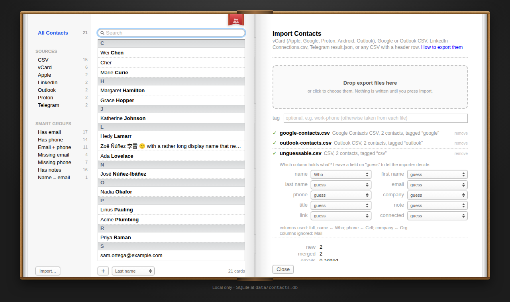
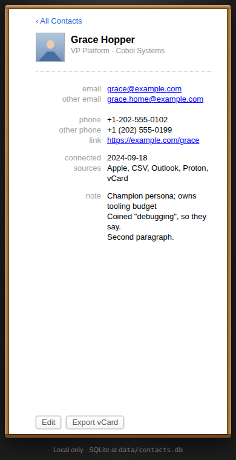

# localcontacts

One local, searchable database for the contacts you have scattered across Google, Apple,
Outlook, Proton, LinkedIn, Telegram and the rest. Runs on your own machine. Nothing leaves it.

Drop in the exports you already have, and the importer recognises each file, de-duplicates
people across them (by email, then phone, then name), keeps every email and phone it finds,
and gives you one list to search, sort, filter and edit.

The interface is Apple's Address Book from OS X Lion and Mountain Lion, measured from the
original and drawn in CSS: the leather book, Groups and Names on the left page, the card on the
right, the red ribbon that shows and hides the groups. It runs in any browser on any OS.







All people in these pictures are made up.

- **[Exporting your contacts](docs/exporting-your-contacts.md)**: step by step for Google, Apple, Microsoft, Proton, LinkedIn, Telegram, Android and more.
- **[Why this exists](docs/ABOUT.md)**: what it is for, what it refuses to do with your data.
- **[Deployment guide](docs/DEPLOY.md)**: your laptop, a home server, Docker, reaching it safely from your phone.
- **[Contributing](CONTRIBUTING.md)**: setup, ground rules, adding an import format.
- **[Security](SECURITY.md)**: how it protects your contacts, and how to report a problem.
- **[Testing](docs/TESTING.md)**: a checklist for trying a release on macOS, Windows and Linux.
- **[Roadmap](docs/ROADMAP.md)**: what is done, what is next.

## Supported exports

| Source | File | Notes |
|---|---|---|
| Apple: iCloud, macOS Contacts, iPhone | `.vcf` | vCard 3.0, groups, photos skipped |
| Google Contacts | `.vcf` or `.csv` | both CSV layouts, multi-value cells |
| Proton Contacts | `.vcf` | vCard 4.0 |
| Outlook, Microsoft 365, Outlook.com | `.csv` | all three email and every phone column |
| Android / Samsung Contacts | `.vcf` | vCard 2.1, quoted-printable names |
| Thunderbird, Fastmail, Nextcloud, any CardDAV | `.vcf` | |
| LinkedIn | `Connections.csv` | profile URL kept, connection date kept |
| Telegram | `result.json` | name and phone |
| Any CRM or spreadsheet | `.csv` with a header row | columns guessed, or named with `--map` |
| Signal, WhatsApp, Messenger, Teams | none | these apps do not export contacts; export your phone's address book instead |

Formats are recognised from the file contents, not the extension. A file that cannot be
recognised stops the run with a hint and nothing is written.

## Requirements

Node.js 22.13 or newer (24 LTS recommended). The app uses Node's built-in `node:sqlite`,
so there is no native build step. Node prints an "SQLite is an experimental feature"
warning on startup; it is harmless.

## Quick start

```bash
npm install
npm run dev        # http://localhost:3000
```

The database is created at `data/contacts.db` on first start. To look around with fake
data before importing your own:

```bash
npm run import -- --apply seed/sample-contacts.csv
```

## Import your own contacts

1. Export from each platform. [Exporting your contacts](docs/exporting-your-contacts.md) has
   the steps for each one; in short:
   - **Google Contacts:** select all → More actions → Export
   - **Apple:** icloud.com/contacts → Actions → Select All Contacts → Share → Export vCard
   - **Outlook.com / Microsoft 365:** People → Manage contacts → Export contacts
   - **Proton:** Contacts → select all → … → Export selection as .VCF
   - **LinkedIn:** Me → Settings & Privacy → Data privacy → Download your data → Connections (arrives by email)
   - **Telegram:** Desktop app → Settings → Advanced → Export Telegram data → Contacts, JSON
   - **Android:** Contacts app → Fix & manage → Export to file
   - **Signal and WhatsApp** do not export contacts; they read your phone's address book, so export that (Apple or Android).
2. In the app, press **Import…** under the groups (on a phone: the groups menu), drop the
   files in, check the summary and press **Import**. Or use the command line, below.

From the command line, put the files in `imports/` (gitignored) or anywhere outside the repo.
The importer is a dry run until you add `--apply`:

```bash
npm run import -- imports/contacts.vcf imports/Connections.csv imports/result.json
npm run import -- --apply imports/contacts.vcf imports/Connections.csv imports/result.json
```

The dry run prints, per file, what it recognised, how many contacts it found and what it
will not keep (postal addresses, birthdays, photos that are only a link), then how many contacts are new and how
many merge into ones you already have. Re-running is safe: a person matched by any email,
then any phone number, then full name is kept once, empty fields are filled in, and further
emails, phones, links and a photo are added. Nothing already stored is overwritten. Two cards
with the same name that disagree on both their emails and their phones are kept apart as two
people; when a name match brings a different job title or company, it goes into the note.

Options:

```
--source=<tag>    origin tag for the files that follow (default: inferred, e.g. apple, google, proton, linkedin)
--map=<spec>      column names for a generic CSV, e.g. --map=full_name=Name,email=Email,phone=Mobile
--country=<CC>    country for phone numbers written without a + prefix (default: US, or CONTACTS_DEFAULT_COUNTRY)
--tag-only        only add the source tag to contacts that already match; insert and change nothing else
--no-backup       skip the database copy normally saved before writing
```

Before writing, both the import page and `--apply` save a copy of the database to
`data/backups/`. To undo an import, stop the app and copy that file over `data/contacts.db`.

## Using the book

- **Arrow keys** move between cards, as in Address Book: up and down, Home and End, Page Up
  and Page Down. They work when the names list has focus or nothing does. With the list focused,
  typing the start of a name jumps to it.
- **Photos**: imported from vCards; in edit mode click the photo square to choose one (JPEG,
  PNG, GIF or WebP, up to 2 MB) or press remove.
- **The ribbon** shows and hides the Groups column.

## Export

```bash
npm run export -- --format=vcard --out=contacts.vcf     # every contact, vCard 3.0
npm run export -- --format=csv --source=linkedin        # CSV to stdout, LinkedIn group only
```

The filters are the book's: `--q`, `--filter` (e.g. `no_email`), `--source`, `--industry`,
`--sort`. vCard keeps every email, phone and link and imports into Apple, Google, Outlook,
Proton and Android; CSV has one column per value (Email, Email 2, …) and opens in any
spreadsheet. Both come back through `npm run import` unchanged, groups, industry and dates
included, and importing one into the book it came from changes nothing; only vCard carries
photos. Each card in the book also has an **Export vCard** button.

## Run it as an app

The server has to run somewhere; these give it an icon and a window of its own.

- **macOS and Linux:** `npm run app` builds once, starts the server and opens it in a
  chromeless window (Chrome, Chromium, Edge, Brave or Vivaldi). Close the window and the server
  stops. `bash scripts/app/install-desktop.sh` adds it to your applications:
  `~/Applications/localcontacts.app` on a Mac, a launcher entry on Linux.
- **Windows:** `scripts\app\launch.cmd` does the same with Edge or Chrome.
- **Any browser:** with the page open, use the browser's install option: the icon in the
  address bar in Chrome, Edge and Brave; File → Add to Dock in Safari; Share → Add to Home
  Screen on an iPhone; Install app in Chrome for Android. Phones need the server reachable over
  HTTPS; see the [deployment guide](docs/DEPLOY.md).

There is no Android or iOS app and no APK: the app is a Node server with a SQLite file, which
a phone cannot run. The installed web app on a phone talks to the server on your computer or
home server.

## Cleanup scripts

All three are dry-run by default; add `--apply` to write. To merge three cards into one, name the
kept card in each pair (`12:34 12:35`); chains like `12:34 34:56` are refused.

```bash
npm run clean:names       [-- --apply]           # tidy names that are really email addresses
npm run merge:dupes -- 12:34 12:35 [--apply]     # merge explicit keepId:dropId pairs, losslessly
npm run classify:industry [-- --apply]           # keyword rules over company + title; fills blanks only
```

## Privacy

Everything is a local SQLite file in `data/`, which is gitignored along with `imports/`
and any `.vcf`, `.csv` or `result.json` at the repo root. No accounts, no telemetry, no AI,
no network calls. [docs/ABOUT.md](docs/ABOUT.md) spells out the rules.

## Test

```bash
npm test             # unit and integration tests
npm run typecheck
npm run test:e2e     # builds the app and runs the browser tests against fake data
```

## Stack

Next.js 16 and React 19 (App Router, TypeScript), `node:sqlite`, `libphonenumber-js`, plain CSS. No other runtime dependencies.

## Layout

- `src/app/page.tsx`: the book. `?id=` opens a card, `&edit=1` edits it, `?new=1` starts one;
  `q`, `filter`, `source`, `industry` and `sort` describe the list and survive every click.
  `src/lib/context.ts` parses them for the page, the API and the export script alike
- `src/app/api/contacts`: the names list as JSON; `src/app/api/vcard/[id]`: one card as a download
- `src/components/`: `Book`, `GroupsPane`, `NamesPane` and `NamesList` (the windowed list),
  `CardPane` with `CardView` and `CardEdit`, `MultiField` (the ⊖ ⊕ rows), `SearchBar`,
  `GroupsToggle` (the ribbon)
- `src/app/globals.css`: the whole Address Book look, with the measurements it came from
- `src/lib/db.ts`: SQLite connection, schema and migrations
- `src/lib/contacts.ts`: queries; `names.ts`, `groups.ts`, `urls.ts`: list sorting, the Groups column, the URL model
- `src/lib/import/`: format detection, one parser per format, phone and email normalisation, the merge engine
- `src/lib/export/`: vCard and CSV writers
- `scripts/import.ts`, `scripts/export.ts`: the command-line importer and exporter; `scripts/app/`: launchers and the desktop installer
- `tests/fixtures/`: fake exports in each platform's real shape

## Licence

MIT. See [LICENSE](LICENSE).
